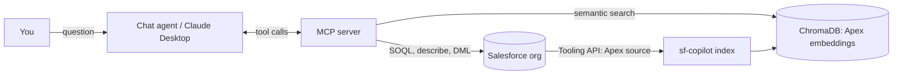

# Salesforce AI Copilot

An AI copilot for Salesforce orgs. Ask questions in plain language ("which accounts in Banking have open opportunities?", "how does our invoice trigger calculate tax?") and the copilot queries your org, reads its schema and searches its Apex code to answer.

It combines three building blocks of modern AI engineering:

| Piece | What it does |
|---|---|
| **MCP server** | Exposes Salesforce as tools (SOQL, describe, get/create/update records, code search) through the [Model Context Protocol](https://modelcontextprotocol.io), so any MCP client (Claude Desktop, Claude Code, Cursor) can use your org. |
| **RAG over Apex** | Pulls every Apex class and trigger through the Tooling API, chunks it, embeds it into a local ChromaDB vector store and serves semantic search with file and line citations. |
| **Agent** | A terminal chat that runs Claude's tool-use loop against the same MCP server, with no duplicated tool definitions. |



## Safety by design

- **Read-only SOQL**: only `SELECT` is accepted, and a `LIMIT` is added automatically so large results never flood the model's context.
- **Writes are off by default** (`SF_ALLOW_WRITES=false`). When enabled, `create_record` / `update_record` first return a **dry-run preview** (before/after) and only execute with `confirm=true`, after the user approves (human in the loop).
- **Input validation** on object names, field names and record Ids.
- **Errors the model can learn from**: Salesforce errors (e.g. `No such column`) are returned to the model so it can fix its query and retry, while unexpected crashes stay on the server.
- MCP **tool annotations** mark read-only vs. write tools for clients that ask before running tools.

## Quick start

Requirements: Python 3.10+, a Salesforce org (a free [Developer Edition](https://developer.salesforce.com/signup) works) and, for the chat agent, an Anthropic API key.

```bash
git clone https://github.com/gustavosemmler/salesforce-ai-copilot.git
cd salesforce-ai-copilot
python -m venv .venv && source .venv/bin/activate   # Windows: .venv\Scripts\activate
pip install -e ".[dev]"

cp .env.example .env        # then fill in your credentials
sf org login web --alias my-dev-org   # easiest auth: reuse the Salesforce CLI session

sf-copilot index            # embed your org's Apex code (first run downloads a small embedding model)
sf-copilot chat             # talk to your org
```

Example session:

```
you> Which custom objects do we have, and what fields does Invoice__c have?
  → list_objects({"custom_only": true})
  → describe_object({"object_name": "Invoice__c"})
copilot> You have 3 custom objects: Invoice__c, Payment__c and Region__c. Invoice__c has ...

you> Where in the code do we send the invoice e-mail?
  → search_apex_code({"question": "send invoice email"})
copilot> In InvoiceService (lines 42-71), sendInvoice() builds a Messaging.SingleEmailMessage ...
```

### Use it from Claude Desktop (or any MCP client)

Add this to your Claude Desktop config (`claude_desktop_config.json`):

```json
{
  "mcpServers": {
    "salesforce": {
      "command": "/full/path/to/.venv/bin/sf-copilot",
      "args": ["serve"],
      "env": { "SF_TARGET_ORG": "my-dev-org", "CHROMA_PATH": "/full/path/to/salesforce-ai-copilot/.chroma" }
    }
  }
}
```

Restart Claude Desktop and the Salesforce tools show up in the chat.

## Configuration

All settings come from environment variables or `.env` (see [.env.example](.env.example)).

| Variable | Default | Purpose |
|---|---|---|
| `SF_TARGET_ORG` | – | Salesforce CLI alias to reuse (recommended) |
| `SF_INSTANCE_URL` + `SF_ACCESS_TOKEN` | – | Alternative: direct session |
| `SF_USERNAME` + `SF_PASSWORD` + `SF_SECURITY_TOKEN` | – | Alternative: username/password (`SF_DOMAIN=test` for sandboxes) |
| `SF_ALLOW_WRITES` | `false` | Enables create/update tools |
| `SF_MAX_ROWS` | `200` | Max rows per SOQL query |
| `CHROMA_PATH` | `.chroma` | Where the vector index is stored |
| `ANTHROPIC_MODEL` | `claude-sonnet-5-5` | Model used by `sf-copilot chat` |

## Project layout

```
sf_copilot/
  tools.py        # Salesforce operations + validation (pure functions, easy to test)
  mcp_server.py   # MCP server: registers the tools, annotations, error handling
  rag.py          # Tooling API fetch, chunking, ChromaDB indexing and search
  agent.py        # Claude tool-use loop that drives the MCP server
  salesforce.py   # Authentication (Salesforce CLI, token, or username/password)
  cli.py          # `sf-copilot serve | index | chat`
tests/            # 20 tests with fake Salesforce + fake embeddings (no network needed)
docs/             # Study guide (Portuguese)
```

## Tests

```bash
pytest
```

Tests run fully offline: Salesforce, Claude and the embedding model are all replaced by fakes, including an end-to-end check of the agent's tool loop and of tool errors flowing back to the model.

## Roadmap

- Index Flows and validation rules alongside Apex
- Hybrid search (keyword + vector) and re-ranking
- An eval set of real questions to measure answer quality
- Data Cloud / Agentforce integration

## License

MIT
